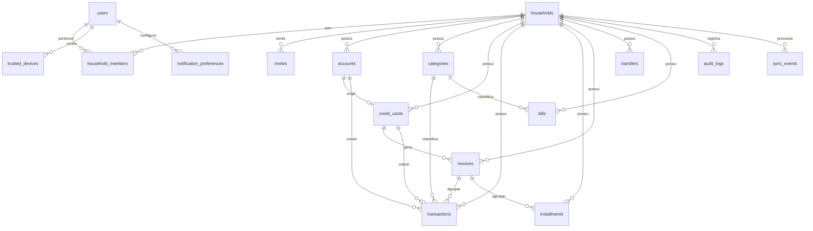

# Data Model — Controle Financeiro Familiar Offline-First

**Fase 1** — entidades persistidas no PocketBase (servidor) e espelhadas no IndexedDB
(Dexie) no cliente. Convenções gerais:

- PK do PocketBase: `id` (string 15). Datas de calendário: `YYYY-MM-DD`. Timestamps: ISO
  UTC (`created`, `updated`). Dinheiro: inteiro de centavos (`*_cents`).
- Todas as entidades de domínio (exceto `users`) têm `household` (FK obrigatória) e são
  isoladas por regra de acesso `household_id = @request.auth.household_member.household`.
- Entidades sincronizáveis têm `sync_id` (UUID), `updated_by` (FK `users`), `deleted_at`
  (soft delete) e `created`/`updated`.
- O cliente mantém cópia local em Dexie com o mesmo formato + metadados de sincronização
  (`_dirty`, `_pendingOutboxId`).

## ERD (visão geral)

## Collections

### users (auth collection)

| Campo | Tipo | Regras |
|-------|------|--------|
| `email` | email (auth) | único, obrigatório |
| `name` | text | obrigatório, 1–80 |
| `avatar` | file (imagem) | opcional, ≤ 2 MB |
| `active` | bool | default `true` |
| `twofa_enabled` | bool | default `false` |
| `twofa_setup_completed` | bool | default `false` |
| `twofa_secret_encrypted` | text | AES-GCM; nunca exposto |
| `recovery_codes_hashed` | json | hashes; nunca exposto |
| `webauthn_credentials` | json | credenciais de App Lock (client) |
| `last_known_device` | text | rótulo do último device |
| `last_login_at` | date | UTC |
| `created` / `updated` | datetime | automáticos |

**Segurança**: campos `twofa_secret_encrypted` e `recovery_codes_hashed` ocultos para
qualquer leitura via API (apenas hooks acessam).

### households

| Campo | Tipo | Regras |
|-------|------|--------|
| `name` | text | obrigatório, 1–80 |
| `base_currency` | text | default `BRL` |
| `supported_currencies` | json | default `["BRL"]` (preparação futura) |
| `settings` | json | preferências gerais |
| `created_by` | relation(users) | obrigatório |
| `sync_id` | text | UUID |
| `updated_by` | relation(users) | — |
| `deleted_at` | datetime | soft delete |
| `created` / `updated` | datetime | — |

### household_members

| Campo | Tipo | Regras |
|-------|------|--------|
| `household` | relation(households) | obrigatório |
| `user` | relation(users) | obrigatório |
| `role` | select | `owner \| partner \| teen \| child \| viewer` |
| `invite_status` | select | `pending \| accepted` |
| `permissions` | json | overrides granulares opcionais |
| `joined_at` | date | — |
| `sync_id` / `updated_by` / `deleted_at` | — | padrão |

**Índice único**: `(household, user)`. **Limite rígido (FR-013)**: no máximo 2 registros com
`role in (owner, partner)` e `deleted_at = null` por household — validado em hook no aceite
do convite.

**Matriz de permissões (FR-010, clarificada)**:

| Capacidade | owner | partner | teen | child | viewer |
|-----------|:----:|:------:|:----:|:-----:|:------:|
| Ler todos os dados financeiros | ✅ | ✅ | ✅ | ❌ (só os próprios) | ✅ |
| Criar/editar/excluir lançamentos | ✅ | ✅ | próprios | próprios | ❌ |
| Gerir contas/cartões/categorias | ✅ | ✅ | ❌ | ❌ | ❌ |
| Convidar membros | ✅ | ✅ | ❌ | ❌ | ❌ |
| Remover membros / alterar papéis | ✅ | ❌ (owner) | ❌ | ❌ | ❌ |
| Configurações de segurança | ✅ | ❌ | ❌ | ❌ | ❌ |
| Exclusão em lote / exportação | ✅ | ✅ | ❌ | ❌ | ❌ |

### invites

| Campo | Tipo | Regras |
|-------|------|--------|
| `household` | relation | obrigatório |
| `role` | select | papéis válidos (não `owner`) |
| `email_invited` | email | obrigatório |
| `token_hash` | text | hash do token CSPRNG; nunca exposto |
| `expires_at` | datetime | `now + 15–30 min` |
| `used_at` | datetime | null até uso |
| `used_by` | relation(users) | null |
| `max_uses` | number | default 1 |
| `single_use` | bool | default `true` |
| `created_by` | relation(users) | — |

### accounts

| Campo | Tipo | Regras |
|-------|------|--------|
| `household` | relation | obrigatório |
| `name` | text | 1–80 |
| `type` | select | `corrente \| poupanca \| carteira \| cartao_credito \| investimento \| outros` |
| `currency` | text | default `BRL` |
| `initial_balance_cents` | number | inteiro |
| `include_in_total` | bool | default `true` |
| `active` | bool | default `true` |
| `order` | number | ordenação |
| `color` / `icon` | text | opcional |
| sync fields | — | `sync_id`, `updated_by`, `deleted_at` |

### credit_cards

| Campo | Tipo | Regras |
|-------|------|--------|
| `household` | relation | obrigatório |
| `account` | relation(accounts) | deve ser `type = cartao_credito`; 1–1 |
| `bank` | text | opcional |
| `limit_cents` | number | inteiro ≥ 0 |
| `currency` | text | default `BRL` |
| `closing_day` | number | 1–31 |
| `due_day` | number | 1–31 |
| `purchase_at_posting` | bool | `compra_no_credenciamento`; default `false` |
| `uses_account_balance_for_invoice` | bool | `usar_saldo_para_fatura`; default `false` |
| `active` | bool | default `true` |
| sync fields | — | padrão |

### categories

| Campo | Tipo | Regras |
|-------|------|--------|
| `household` | relation | obrigatório |
| `name` | text | 1–60 |
| `kind` | select | `entrada \| saida` |
| `group` | text | agrupamento (Moradia, Alimentação, …) |
| `color` / `icon` | text | — |
| `system` | bool | default `false`; `true` não pode ser excluída |
| `active` | bool | default `true` |
| `order` | number | — |
| sync fields | — | padrão |

**Seed BR**: categorias de `constants/categories-seed.ts` (`system=true`) criadas no
onboarding do household (FR-048/FR-049).

### transactions

| Campo | Tipo | Regras |
|-------|------|--------|
| `household` | relation | obrigatório |
| `account` | relation(accounts) | obrigatório |
| `credit_card` | relation(credit_cards) | nullable |
| `amount_cents` | number | inteiro > 0 |
| `currency` | text | default `BRL` |
| `type` | select | `receita \| despesa \| transferencia` |
| `date` | date | data do lançamento |
| `posting_date` | date | nullable |
| `attribution` | select | `meu \| dela \| ambos \| indefinido` |
| `payer_user` | relation(users) | nullable |
| `category` | relation(categories) | nullable (obrigatório para receita/despesa) |
| `description` | text | ≤ 200 |
| `status` | select | `pago \| a_pagar` |
| `recurrence` | relation | nullable (Fase 6) |
| `installment` | relation(installments) | nullable |
| `invoice` | relation(invoices) | nullable (preenchido se cartão) |
| `transfer` | relation(transfers) | nullable |
| `attachment` | file | opcional ≤ 5 MB |
| `tags` | json | `string[]` |
| `note` | text | ≤ 1000 |
| sync fields | — | `sync_id`, `updated_by`, `deleted_at` |

**Validações**: `type=transferencia` ⇒ `transfer` preenchido e não entra em receita/despesa;
`credit_card` preenchido ⇒ `invoice` calculado; `child` só cria/edita quando
`payer_user = self`.

### installments

| Campo | Tipo | Regras |
|-------|------|--------|
| `household` | relation | obrigatório |
| `installment_group_id` | text | agrupa parcelas da compra |
| `root_transaction` | relation(transactions) | compra raiz |
| `number` | number | 1..total |
| `total` | number | ≥ 1 |
| `amount_cents` | number | rateio (soma = valor da compra) |
| `expected_date` | date | competência da parcela |
| `invoice` | relation(invoices) | alocada por ciclo |
| `paid` | bool | default `false` |
| sync fields | — | padrão |

**Regra**: cada parcela é alocada à fatura cujo ciclo contém `expected_date`, com linha de
corte inclusiva (FR-031/FR-035); `sum(amount_cents) == compra` (a diferença de centavos por
divisão é aplicada na última parcela).

### invoices

| Campo | Tipo | Regras |
|-------|------|--------|
| `household` | relation | obrigatório |
| `credit_card` | relation(credit_cards) | obrigatório |
| `account` | relation(accounts) | obrigatório |
| `reference_month` | text | `YYYY-MM` |
| `closing_date` | date | calculado do `closing_day` (clamp) |
| `due_date` | date | calculado do `due_day` |
| `total_cents` | number | soma dos lançamentos/parcelas |
| `paid_cents` | number | default 0 |
| `status` | select | `aberta \| fechada \| paga \| vencida` |
| `closed_at` / `paid_at` | datetime | nullable |
| `note` | text | ≤ 1000 |
| sync fields | — | padrão |

**Índice único**: `(credit_card, reference_month)`.
**Transições**: `aberta → fechada` (na `closing_date`) → `paga` (baixa); `aberta|fechada →
vencida` quando `due_date < today` e não paga; `vencida → paga` permitido.

### transfers

| Campo | Tipo | Regras |
|-------|------|--------|
| `household` | relation | obrigatório |
| `source_account` | relation(accounts) | obrigatório |
| `destination_account` | relation(accounts) | obrigatório, ≠ origem |
| `amount_cents` | number | inteiro > 0 |
| `currency` | text | default `BRL` |
| `date` | date | — |
| `description` | text | ≤ 200 |
| `source_transaction` | relation | gerado |
| `destination_transaction` | relation | gerado |
| sync fields | — | padrão |

### bills

| Campo | Tipo | Regras |
|-------|------|--------|
| `household` | relation | obrigatório |
| `title` | text | 1–120 |
| `amount_cents` | number | inteiro > 0 |
| `currency` | text | default `BRL` |
| `type` | select | `fixa \| variavel` |
| `nature` | select | `saida \| entrada` |
| `due_date` | date | obrigatório |
| `periodicity` | select | `unica \| mensal \| bimestral \| trimestral \| anual \| personalizada` |
| `status` | select | `pendente \| pago \| cancelado` |
| `attribution` | select | `meu \| dela \| ambos` |
| `responsible_user` | relation(users) | nullable |
| `category` | relation(categories) | nullable |
| `recurrence` | relation | nullable (Fase 6) |
| `reminder_config` | json | preparação para Fase 5 |
| `last_generation` / `next_generation` | date | nullable |
| sync fields | — | padrão |

**Transições**: `pendente → pago`, `pendente → cancelado`, `pago/cancelado → pendente`
(reativação com auditoria).

### sync_events (idempotência)

| Campo | Tipo | Regras |
|-------|------|--------|
| `household` | relation | obrigatório |
| `user` | relation(users) | autor |
| `entity` | select | nome da collection |
| `entity_id` | text | id remoto ou local |
| `sync_id` | text | UUID do cliente |
| `operation` | select | `create \| update \| delete` |
| `client_ts` | datetime | timestamp do cliente |
| `server_ts` | datetime | quando aplicado |
| `result` | select | `applied \| conflict \| ignored \| error` |
| `detail` | json | payload/erro resumido |

**Índice único**: `(household, entity, sync_id)`.

### audit_logs (append-only)

| Campo | Tipo | Regras |
|-------|------|--------|
| `household` | relation | obrigatório |
| `user` | relation(users) | autor |
| `action` | text | ex.: `transaction.delete`, `member.role.update` |
| `entity` / `entity_id` | text | alvo |
| `before` / `after` | json | snapshots relevantes (sem segredos) |
| `ip` / `user_agent` | text | contexto |
| `created` | datetime | automático |

Somente hooks escrevem; leitura restrita a `owner`/`partner`.

### trusted_devices

| Campo | Tipo | Regras |
|-------|------|--------|
| `user` | relation(users) | obrigatório |
| `label` | text | rótulo do dispositivo |
| `token_hash` | text | hash do token de confiança |
| `user_agent` / `ip` | text | contexto |
| `last_seen_at` | datetime | — |
| `expires_at` | datetime | `now + 30 dias` |
| `revoked_at` | datetime | nullable |

### notification_preferences (estrutura futura — Fase 5)

| Campo | Tipo |
|-------|------|
| `user` / `household` | relation |
| `push_enabled` | bool |
| `webpush_subscription` | json |
| `reminders` | json (`contas_a_pagar`, `fatura_cartao`, `fixas`, `recorrentes`, `quiet_hours`, `horario_envio`) |

### change_log (infra de sync — tabela SQLite)

Criada por migração; não exposta via API.

| Coluna | Tipo | Observação |
|--------|------|------------|
| `seq` | INTEGER PK AUTOINCREMENT | cursor monotônico |
| `household_id` | TEXT | isolamento |
| `entity` | TEXT | collection alterada |
| `entity_id` | TEXT | registro alterado |
| `operation` | TEXT | create/update/delete |
| `changed_at` | TEXT | ISO UTC |

## Regras de negócio derivadas da spec

1. **Fatura/ciclo (FR-031/FR-035)**: linha de corte inclusiva — compra com `date` ≤
   `closing_date` entra na fatura que fecha nesse dia; `>` entra na próxima. Cada parcela
   usa a mesma regra sobre `expected_date`.
2. **Transferência (FR-023–FR-025)**: cria transações na origem/destino, não altera totais
   de receita/despesa; origem ≠ destino.
3. **Saldo (FR-018)**: `initial_balance_cents` + receitas pagas − despesas pagas
   (transferências movem entre contas, sem efeito no total).
4. **Conflitos (FR-042/FR-043)**: LWW por `updated_at` do servidor; empate → servidor;
   `conflict=true` no item; update de item com `deleted_at` é descartado.
5. **Idempotência (FR-040)**: reenvio com mesmo `(household, entity, sync_id)` retorna o
   resultado anterior sem reaplicar.
6. **Soft delete (FR-022)**: `deleted_at` é incluído no `pull` para remoção local.
7. **Limite de membros (FR-013)**: 2 adultos plenos; dependentes sem limite rígido.
8. **Isolamento (FR-009)**: toda consulta/mutação valida `household` no backend.
