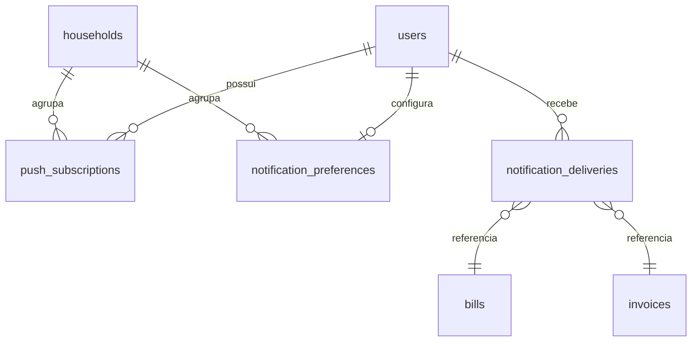

# Data Model — PWA Instalável e Notificações Configuráveis

**Fase 1** — novas collections no PocketBase (servidor) espelhadas no IndexedDB (Dexie)
quando fizer sentido. Convenções gerais como na feature 001 (PK `id`, `household`
obrigatório, `sync_id`/`updated_by`/`deleted_at`, timestamps UTC, `*_cents`).

## ERD (novas entidades)



## Collections

### push_subscriptions

| Campo | Tipo | Regras |
|-------|------|--------|
| `household` | relation(households) | obrigatório |
| `user` | relation(users) | obrigatório |
| `endpoint` | text | obrigatório, único por usuário |
| `p256dh` | text | chave pública do cliente |
| `auth` | text | segredo de autenticação do cliente |
| `user_agent` | text | contexto/rotulagem |
| `label` | text | rótulo amigável do dispositivo |
| `last_seen_at` | datetime | atualizado no uso |
| `revoked_at` | datetime | null enquanto válida |
| sync fields | — | `sync_id`, `updated_by`, `deleted_at` |

**Segurança**: `endpoint`/`p256dh`/`auth` são credenciais de entrega; nunca retornados a
outros usuários e removidos ao desativar (FR-001/FR-002/FR-004).

### notification_preferences

| Campo | Tipo | Regras |
|-------|------|--------|
| `household` | relation | obrigatório |
| `user` | relation | obrigatório, único por household |
| `push_enabled` | bool | opt-in geral |
| `preferences` | json | ver schema abaixo |
| sync fields | — | padrão |

**`preferences` (schema Zod em `@cf/shared/domain/notifications.ts`)**:

```json
{
  "contas_a_pagar": { "habilitado": true, "dias_antes": [3, 1] },
  "contas_a_receber": { "habilitado": false, "dias_antes": [3] },
  "fatura_cartao": { "habilitado": true, "dias_antes": [7, 3, 1] },
  "fixas_recorrentes": { "habilitado": true, "dias_antes": [3] },
  "horario_envio": "08:30",
  "quiet_hours": { "ativar": true, "inicio": "22:00", "fim": "07:00" }
}
```

**Validações**:
- `horario_envio` no formato `HH:MM` (00:00–23:59).
- `inicio`/`fim` de quiet hours em `HH:MM`; `inicio !== fim`.
- `dias_antes` ⊆ conjunto permitido por tipo: contas `{1,2,3,5,7,15,30}`, fatura
  `{1,3,5,7,10,15}`, fixas/recorrentes `{1,2,3,5,7}`; lista sem duplicatas e ≥ 0 itens.
- Se ausente, aplica defaults: `horario_envio = "08:30"`, quiet hours `22:00–07:00`
  (FR-023).

### notification_deliveries

| Campo | Tipo | Regras |
|-------|------|--------|
| `household` | relation | obrigatório |
| `user` | relation | obrigatório |
| `kind` | select | `contas_a_pagar \| contas_a_receber \| fatura_cartao \| fixas_recorrentes` |
| `entity` | text | `bills` ou `invoices` |
| `entity_id` | text | id do item |
| `scheduled_date` | date | dia do lembrete (`YYYY-MM-DD` no fuso de negócio) |
| `due_date` | date | vencimento do item |
| `title` | text | ex.: título da conta / fatura |
| `amount_cents` | number | inteiro |
| `status` | select | `pendente \| enviado \| falho \| descartado` |
| `attempts` | number | tentativas |
| `last_error` | text | sem dados sensíveis |
| `sent_at` | datetime | quando entregue |

**Índice único**: `(user, kind, entity, entity_id, scheduled_date)` — garante FR-014.
**Transições**: `pendente → enviado` (sucesso), `pendente → falho` (erro), `falho →
pendente` (retry); `pendente → descartado` quando o item foi pago/cancelado/removido ou o
usuário perdeu acesso (FR-013/FR-016).

## Regras de negócio derivadas da spec

1. **Elegibilidade**: um item gera lembrete para um usuário quando
   `status` do item é pendente/aberta/fechada, `due_date - N == hoje` para algum `N` em
   `dias_antes` habilitado, o usuário tem inscrição válida e `push_enabled = true`.
   Faturas (`fatura_cartao`) têm prioridade de processamento (FR-011).
2. **Janela de envio**: o lembrete é emitido quando o horário atual ≥ `horario_envio` no
   fuso `America/Sao_Paulo`; se esse horário estiver na quiet hours, adiar para o fim do
   silêncio (FR-007/FR-008/FR-009/FR-015).
3. **Deduplicação**: no máximo um envio por `(user, kind, entity, entity_id,
   scheduled_date)`; o registro é criado como `pendente` antes do envio (FR-014).
4. **Descarte**: itens pagos/cancelados/soft-deleted, households inativos ou usuários
   removidos/bloqueados resultam em `descartado` e nenhum envio (FR-013/FR-016).
5. **Conteúdo**: título, valor em centavos e data de vencimento (FR-012).
6. **Pagamento**: baixar uma conta/cancelar remove os lembretes pendentes relacionados.

## Contrato compartilhado (`@cf/shared`)

- `notificationPreferencesSchema` (Zod) + `DEFAULT_NOTIFICATION_PREFERENCES`.
- `REMINDER_DAYS_OPTIONS` por tipo.
- Funções puras em `domain/notifications.ts`:
  - `isQuietHours(time, quietHours): boolean`
  - `nextAllowedTime(now, horario, quietHours): { date: string; time: string }`
  - `dueReminderDays(dueDate, daysBefore, today): number | null`
  - `isDeliveryDuplicate(existing, candidate): boolean`

## Impacto em entidades existentes

- `bills`: usa `due_date`, `status`, `title`, `amount_cents`, `household`, `responsible_user`.
- `invoices`: usa `due_date`, `status` (`aberta|fechada`), `total_cents`, `household`,
  `credit_card`.
- Nenhum campo novo obrigatório nessas collections.
